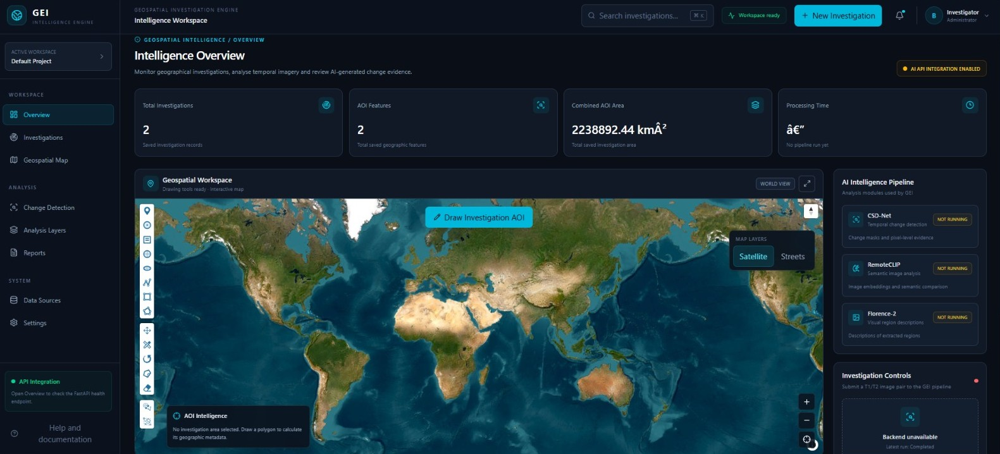
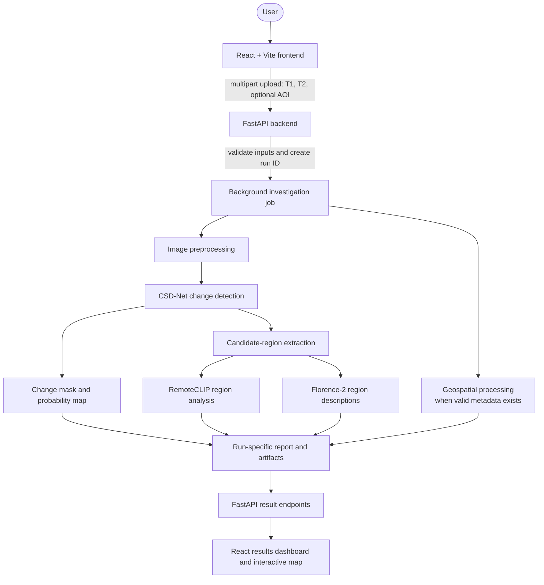

<div align="center">


<br/>


[Overview](#overview) · [Features](#key-features) · [Architecture](#system-architecture) · [Setup](#setup-and-run) · [API](#api-overview) · [Limitations](#limitations)

<br/>



</div>

An AI-assisted geospatial change-detection and investigation platform that compares imagery captured at different times, identifies candidate change regions, enriches them with vision-language analysis, and presents the evidence through an interactive dashboard.

> [!NOTE]
> **Project status:** Core development and stabilization completed. The system is intended to assist human investigation; its outputs are model predictions and must be independently verified.

---

## Table of Contents

<details>
<summary><b>Expand all sections</b></summary>
<br/>

-   [Overview](#overview)
-   [Problem Statement](#problem-statement)
-   [Key Features](#key-features)
-   [System Architecture](#system-architecture)
-   [Investigation Workflow](#investigation-workflow)
-   [Technology Stack](#technology-stack)
-   [Repository Structure](#repository-structure)
-   [Prerequisites](#prerequisites)
-   [Setup and Run](#setup-and-run)
-   [Using the Application](#using-the-application)
-   [API Overview](#api-overview)
-   [Outputs and Storage](#outputs-and-storage)
-   [Geospatial Processing](#geospatial-processing)
-   [Testing](#testing)
-   [Limitations](#limitations)
-   [Future Enhancements](#future-enhancements)
-   [Responsible Use](#responsible-use)

</details>

---

## Overview

Geospatial Investigation Engine (GEI) is a full-stack application for
analysing changes between two images of the same geographical area
captured at different points in time.

The user supplies an earlier image (**T1**) and a later image (**T2**).
The backend processes the pair using a CSD-Net-based change-detection
pipeline, extracts candidate regions, and performs additional analysis
using RemoteCLIP and Florence-2. Where supported georeferencing metadata
is available, candidate regions can also be converted from image pixel
coordinates into geographic features and displayed on an interactive
map.

The application combines:

1.  Pixel-level change detection.
2.  Candidate-region extraction.
3.  Vision-language-based temporal and semantic analysis.
4.  Natural-language descriptions of candidate regions.
5.  AOI association and geospatial representation when valid
    georeferencing is available.
6.  Investigation history, reports, and downloadable artifacts.

GEI is designed as an investigation-assistance tool. It does not
independently establish whether a detected change is illegal
construction or another confirmed real-world event.

---

## Problem Statement

Comparing large geographical images manually is time-consuming and can
make it difficult to consistently identify, inspect, and document
changes.

GEI aims to streamline this workflow by automating image comparison,
organising detected regions, providing supplementary AI-based
interpretations, and presenting the resulting evidence in one
application.

---

## Key Features

<table>
<tr>
<th width="33%">Detect</th>
<th width="33%">Interpret</th>
<th width="33%">Investigate</th>
</tr>
<tr>
<td valign="top">CSD-Net compares T1 and T2 at pixel level and extracts candidate regions.</td>
<td valign="top">RemoteCLIP and Florence-2 add semantic context and descriptions.</td>
<td valign="top">A dashboard brings together imagery, maps, reports and artifacts.</td>
</tr>
</table>

### Image upload and investigation management

-   Upload an earlier T1 image and a later T2 image.
-   Validate image inputs before processing.
-   Associate an optional Area of Interest (AOI).
-   Create a unique run ID for each investigation.
-   Track queued, running, completed, and failed states.
-   Retain the frontend investigation index in browser local storage.

### AI-based change detection

-   CSD-Net-based image-pair analysis using a Siamese encoder-based
    architecture.
-   Pixel-level change prediction.
-   Change masks and probability-map outputs.
-   Candidate-region extraction from connected changed areas.
-   Region information such as bounding boxes, centroids, and pixel
    area, where available.

### Vision-language analysis

-   **RemoteCLIP:** supplementary temporal and semantic analysis of
    candidate regions using image and text representations.
-   **Florence-2:** natural-language descriptions of candidate image
    regions.

These outputs provide additional context. Similarity scores are not
calibrated probabilities, and generated descriptions may be inaccurate.

### Geospatial integration

-   Optional AOI association and retrieval.
-   GeoTIFF metadata inspection.
-   Pixel-to-geographic coordinate conversion for supported
    georeferencing cases.
-   WGS84 GeoJSON generation for mapped candidate regions.
-   Interactive map presentation using MapLibre.
-   Graceful handling of missing or unsupported georeferencing.

### Investigation results dashboard

-   Executive summary and processing information.
-   Original T1 and T2 imagery.
-   Change mask, probability map, and overlay when generated.
-   Candidate-region inspection.
-   RemoteCLIP and Florence-2 analysis.
-   Geospatial metadata and mapped features when available.
-   Report and artifact retrieval.
-   PNG preview fallback for original TIFF images when the browser
    cannot display TIFF directly.

---

## System Architecture

GEI has three main layers.

### 1. Frontend

The frontend is built with React and Vite. It provides the upload
workflow, investigation history, results dashboard, and interactive map.

MapLibre is used for map rendering, with Geoman providing map drawing
tools for AOI workflows.

### 2. Backend

The backend is built with Python and FastAPI. It validates uploads,
creates investigation runs, schedules processing, manages run-specific
files, exposes API endpoints, and coordinates AI and geospatial
processing.

### 3. AI and geospatial processing

The processing pipeline uses:

-   **CSD-Net:** primary change-detection component.
-   **RemoteCLIP:** supplementary image-text and temporal/semantic
    analysis.
-   **Florence-2:** candidate-region descriptions.
-   **OpenCV and Pillow:** image processing and image I/O.
-   **Geospatial utilities:** GeoTIFF metadata inspection, coordinate
    conversion, and GeoJSON generation.

### High-level workflow



---

## Investigation Workflow

1.  **Upload:** The user selects T1 and T2 images and may associate a
    saved AOI.
2.  **Validation:** The backend checks that the required files are
    present, decodable, supported, and dimensionally compatible.
3.  **Run creation:** The backend creates a unique run ID and returns an
    accepted response.
4.  **Background processing:** The investigation moves through queued
    and running states while the AI pipeline executes.
5.  **Preprocessing:** Images are loaded and transformed into the format
    expected by the change-detection model. The pipeline uses
    normalization and patch-based processing as configured by the
    implementation.
6.  **Change detection:** CSD-Net generates change predictions and
    related visual outputs.
7.  **Region extraction:** Connected changed pixels are grouped into
    candidate regions.
8.  **AI interpretation:** RemoteCLIP performs supplementary temporal
    and semantic analysis. Florence-2 generates descriptions for
    candidate regions when applicable.
9.  **Geospatial processing:** If both images have supported, compatible
    georeferencing, candidate pixel geometry can be transformed into
    geographic features.
10. **Reporting:** The backend stores a structured report and generated
    artifacts in the run directory.
11. **Results:** The frontend retrieves the report, images, artifacts,
    AOI, and geospatial outputs and presents them to the user.

The frontend checks the run status periodically while processing is
active. The upload request does not need to remain open for the full
duration of AI inference.

---

## Technology Stack

<div align="center">


</div>

<br/>

| Layer | Technologies | Purpose |
| :--- | :--- | :--- |
| Frontend | React, Vite, JavaScript | User interface and application workflow |
| Mapping | MapLibre, Geoman | Interactive map and AOI drawing |
| Backend | Python, FastAPI | API, validation, job orchestration |
| Deep learning | PyTorch and project model dependencies | Model inference |
| Change detection | CSD-Net implementation | Pixel-level change prediction |
| Vision-language analysis | RemoteCLIP | Image-text similarity and region analysis |
| Image descriptions | Florence-2 | Natural-language region descriptions |
| Image processing | OpenCV, Pillow | Image loading and processing |
| Geospatial output | GeoTIFF metadata, GeoJSON | Geographic coordinate handling and feature output |
| API communication | HTTP/REST, JSON, multipart form data | Frontend/backend communication |

---

## Repository Structure

The main application directories are:

``` text
GEI/
├── 🧠 model_engine/
│   ├── ⚙️ api/
│   │   ├── main.py
│   │   ├── jobs.py
│   │   ├── geospatial.py
│   │   ├── 🧪 test_jobs.py
│   │   └── 🧪 test_geospatial.py
│   ├── 🗺️ manual-test-fixtures/
│   │   └── geospatial/
│   └── 📦 outputs/
│       └── api_runs/
└── 🖥️ gei-frontend/
    └── src/
        ├── 🧩 components/
        │   ├── dashboard/
        │   └── investigations/
        ├── 📄 pages/
        └── 🔌 services/
```

This is a high-level view of the principal application areas, not an
exhaustive listing of every model, configuration, or frontend file. The
exact repository may contain additional directories and files.

---

## Prerequisites

Install the following before running the application:

-   Python compatible with the backend dependencies. The project has
    been exercised in a Python 3.13 environment.
-   Node.js and npm compatible with the frontend dependencies.
-   Git, if cloning or managing the repository.
-   The model checkpoints and other assets required by the AI pipeline.
-   Sufficient CPU/GPU memory for the configured models. GPU
    availability depends on the installed PyTorch build and hardware.

The backend virtual environment and dependency files should be taken
from the project checkout. Do not assume that a model checkpoint is
included in the repository; verify the required model assets and
configuration before running inference.

---

## Setup and Run

The commands below assume the repository root contains `model_engine/`
and `gei-frontend/`.

### 1. Backend setup

Open a terminal:

``` powershell
cd model_engine
```

If the project virtual environment already exists, activate it:

``` powershell
.\.venv\Scripts\Activate.ps1
```

If it does not exist, create it using an installed compatible Python
version:

``` powershell
py -3.13 -m venv .venv
.\.venv\Scripts\Activate.ps1
```

Install the dependencies using the dependency manifest provided in the
checkout. For example, if the backend contains a `requirements.txt`:

``` powershell
python -m pip install -r requirements.txt
```

Confirm that the required model checkpoints and configuration are
available. Then start the API:

``` powershell
.\.venv\Scripts\python.exe -m uvicorn api.main:app --host 127.0.0.1 --port 8000
```

Backend API:

``` text
http://127.0.0.1:8000
```

Interactive API documentation:

``` text
http://127.0.0.1:8000/docs
```

### 2. Frontend setup

Open a second terminal:

``` powershell
cd gei-frontend
```

Install frontend dependencies:

``` powershell
npm install
```

Start the development server:

``` powershell
npm run dev
```

To make the development server available on the local interface
explicitly:

``` powershell
npm run dev -- --host 127.0.0.1
```

Open the local URL printed by Vite in the terminal.

### 3. Production build

From `gei-frontend/`:

``` powershell
npm run build
```

To run the built frontend locally:

``` powershell
npm run preview
```

The exact frontend API base URL and any required environment
configuration should be checked in the project's existing configuration
before deployment.

---

## Using the Application

1.  Start the backend and frontend.
2.  Open the GEI frontend in a browser.
3.  Navigate to the investigation upload workflow.
4.  Select the earlier T1 image and later T2 image.
5.  Optionally select or associate an AOI.
6.  Submit the investigation.
7.  Wait for the run to move from queued/running to completed or failed.
8.  Open the completed investigation.
9.  Review the executive summary, original imagery, change outputs, and
    candidate regions.
10. Inspect RemoteCLIP and Florence-2 information where candidate
    regions are available.
11. Review the AOI and geospatial map when geographic mapping is
    available.
12. Open or download the investigation report and generated artifacts.

The input pair must represent the same area and have compatible
dimensions. Matching dimensions alone do not guarantee that the images
are geographically or visually aligned.

---

## API Overview

The following run-scoped endpoints are used by the application. The
`{run_id}` placeholder must be replaced with the ID returned when an
investigation is created.

| Method | Endpoint | Purpose |
| :---: | :--- | :--- |
| `GET` | `/api/health` | Backend health information |
| `POST` | `/api/investigations` | Create an investigation |
| `GET` | `/api/investigations/{run_id}` | Retrieve investigation status |
| `GET` | `/api/investigations/{run_id}/report` | Retrieve the investigation report |
| `GET` | `/api/investigations/{run_id}/files` | List run artifacts |
| `GET` | `/api/investigations/{run_id}/inputs/t1` | Retrieve original T1 image |
| `GET` | `/api/investigations/{run_id}/inputs/t2` | Retrieve original T2 image |
| `GET` | `/api/investigations/{run_id}/inputs/{image_type}/preview` | Retrieve a PNG preview of T1 or T2 |
| `GET` | `/api/investigations/{run_id}/aoi` | Retrieve associated AOI |
| `GET` | `/api/investigations/{run_id}/geospatial` | Retrieve geospatial metadata |
| `GET` | `/api/investigations/{run_id}/regions.geojson` | Retrieve candidate-region GeoJSON |

The investigation creation endpoint accepts multipart form data. The
image fields are required; AOI GeoJSON and AOI metadata are optional.

For the exact request schema, response structures, and error codes,
consult the running FastAPI documentation at `/docs`.

---

## Outputs and Storage

Investigation data is stored separately for each run. The backend uses a
run-specific output directory, with the run ID separating inputs,
reports, metadata, and generated artifacts.

A simplified example:

``` text
outputs/
└── api_runs/
    └── <run_id>/
        ├── inputs/
        │   ├── image_t1.png
        │   └── image_t2.png
        ├── outputs/
        │   ├── change_mask.png
        │   ├── probability_map.png
        │   ├── overlay.png
        │   └── ...
        ├── pipeline_report.json
        ├── aoi.geojson
        ├── aoi_metadata.json
        └── geospatial_metadata.json
```

This is an illustrative structure; the exact artifact names and files
depend on the pipeline output for a particular run.

The frontend keeps its visible AI investigation index in browser local
storage under:

``` text
gei_ai_investigation_runs
```

This browser-side index is separate from the backend's run files.
Clearing browser storage can remove the visible history index even when
backend run data still exists.

---

## Geospatial Processing

### Pixel coordinates and geographic coordinates

A normal image provides pixel coordinates such as `(column, row)`. Those
coordinates do not identify a location on Earth.

A georeferenced raster contains metadata that defines how pixel
positions relate to a coordinate reference system. GEI inspects
supported GeoTIFF metadata and uses the associated transform to convert
candidate-region geometry when the required conditions are satisfied.

### Supported cases

The implemented conversion supports:

-   WGS84 / EPSG:4326.
-   Web Mercator / EPSG:3857, transformed to WGS84 output.

Unsupported CRS definitions, missing georeferencing, or incompatible
image transforms result in geographic mapping being reported as
unavailable. Pixel-space detections remain available.

### AOI is not georeferencing

An AOI describes the geographical boundary of an investigation. It does
not, by itself, provide a reliable pixel-to-geographic transformation
for an uploaded image.

### Alignment caveat

Matching raster transforms provide coordinate alignment information but
do not independently prove that the image content is visually
co-registered. Misalignment, differences in acquisition conditions, and
image quality can affect change-detection results.

---

## Testing

### Backend tests

The backend test suite uses Python's built-in `unittest` framework.

From `model_engine/`:

``` powershell
.\.venv\Scripts\python.exe -m unittest discover -v
```

The latest reported stabilization run completed with **33 tests passed,
0 failures, and 0 errors**. Re-run the command against the current
checkout to confirm its present status.

### Frontend lint

From `gei-frontend/`:

``` powershell
npm run lint
```

### Frontend production build

From `gei-frontend/`:

``` powershell
npm run build
```

The latest reported checks passed. Vite displayed an advisory about one
or more generated JavaScript chunks exceeding 500 kB; this is a
bundle-size warning, not a failed build.

### Manual browser verification

For a complete demonstration, verify:

-   PNG/JPEG upload and results display.
-   TIFF upload and PNG preview fallback where the browser cannot
    display TIFF directly.
-   Investigations with and without AOIs.
-   Completed and failed run states.
-   Report and artifact downloads.
-   Map display when georeferencing is available.
-   Unavailable-georeferencing messaging when it is not.
-   Switching between investigations without stale results or map
    layers.
-   Candidate-feature selection using a run with non-empty GeoJSON.

A synthetic fixture that produces zero candidate regions can verify
processing and empty-result handling, but cannot verify non-empty
candidate-feature interaction or real-world detection accuracy.

---

## Limitations

> [!IMPORTANT]
> Read these before interpreting any result.

1.  **Detection is not verification:** CSD-Net identifies potential
    visual changes. It does not establish the real-world meaning or
    legality of a change.
2.  **Image alignment matters:** Equal image dimensions do not guarantee
    that corresponding pixels represent the same ground location.
3.  **False positives and negatives:** Shadows, seasonal changes,
    illumination, image quality, and misalignment can affect
    predictions.
4.  **Semantic uncertainty:** RemoteCLIP similarity scores are embedding
    similarities, not calibrated probabilities.
5.  **Description uncertainty:** Florence-2 descriptions may be
    inaccurate and require visual verification.
6.  **Georeferencing dependency:** Geographic candidate mapping is
    available only when supported, valid georeferencing metadata is
    present.
7.  **CRS coverage:** The implemented conversion supports specific CRS
    cases; unsupported systems are reported as unavailable.
8.  **Evaluation:** Reliable accuracy claims require evaluation against
    labelled real-world datasets using suitable metrics such as
    precision, recall, F1-score, and Intersection over Union (IoU).

---

## Future Enhancements

Potential future work includes:

-   Integration with satellite imagery providers and automated
    multi-date acquisition.
-   More robust image co-registration.
-   Support for additional coordinate reference systems.
-   Evaluation and calibration using labelled remote-sensing datasets.
-   Improved building, road, and land-use change classification.
-   Multi-date change tracking.
-   Scalable background job processing and cloud deployment.
-   User authentication, roles, and investigation access controls.
-   Enhanced report export and investigation audit trails.

---

## Responsible Use

GEI provides AI-generated candidate detections and supplementary
interpretations to support human investigation. Users should inspect the
original imagery, validate geospatial alignment, and independently
verify model outputs before making operational, legal, or policy
decisions.

---

## Author

<div align="center">

**Aryan Sengar**

[](https://github.com/aryansengar007)
[](https://aryan-sengar-portfolio-v2.netlify.app)

---

**Geospatial Investigation Engine (GEI)**<br/>
AI-assisted change detection, region analysis, and geospatial investigation.

<br/>

*If you found this project helpful or inspiring, consider leaving a* ⭐ *because it means a lot!*

</div>


